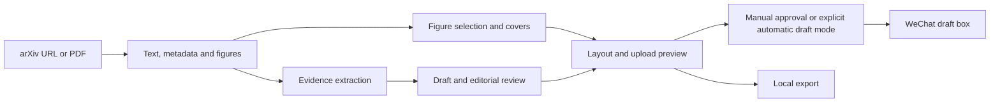

<div align="center">

# Paper Studio

**Read the paper. Build the story. Review the evidence.**

A local Windows workspace for turning research papers into illustrated WeChat articles.

[Quick Start](#quick-start) · [User Guide](docs/USAGE.md) · [Troubleshooting](docs/TROUBLESHOOTING.md) · [Privacy](SECURITY.md) · [License](#license)


</div>

Paper Studio brings paper intake, figure preparation, evidence-linked writing, editing, and WeChat draft delivery into one desktop workflow. Import an arXiv URL or a PDF, connect your own model provider, and build a Chinese research article with original figures and source information.

**Source available for noncommercial use.** This application is not offered under an OSI-approved open-source license. The surrounding AutoDrive research catalog has a separate license. See [License](#license) before using or redistributing the application.

## Features

| Stage | Capabilities |
|---|---|
| Discover | Fetch arXiv titles and links first; filter driving, world models, embodied AI, agents/RSI, AI infrastructure, and foundation-model topics. |
| Read | Extract PDF text, page references, hyperlinks, captions, tables, and image candidates; identify arXiv metadata when available. |
| Illustrate | Detect caption-based crops, extract native-resolution embedded images, import PNG/JPEG replacements, and adjust crops manually. |
| Write | Extract evidence, draft a full article, and run an editorial pass; recover stage checkpoints and continue truncated responses within bounded retries. |
| Design | Choose editorial styles, preview mobile layouts, generate local typographic covers, and optionally apply Baoyu Markdown formatting. |
| Review | Inspect paper identity, resource links, numeric evidence, figure completeness, and the exact upload preview. |
| Deliver | Upload images and create a WeChat draft through the official API, with receipts and duplicate-submission protection. |
| Export | Save Markdown, HTML, structured article data, and ZIP material bundles for offline editing. |

The UI and editorial prompts currently target **Chinese-language WeChat articles**. Documentation is in English. Cover generation uses local templates and paper information; it is not a built-in image-generation model.

## Quick start

Requirements: Windows 10/11 64-bit, Python **3.11** with the `py` launcher, and Microsoft Edge WebView2 Runtime. Automated writing needs an OpenAI-compatible Chat Completions endpoint. Node.js/npm is optional for Baoyu formatting. WeChat API delivery requires your own eligible account and material/draft permissions.

```powershell
git clone https://github.com/Rtwotwo/AutoDrive.git
cd AutoDrive\paper-studio
powershell -NoProfile -ExecutionPolicy Bypass -File .\setup.ps1
.\start.cmd
```

Setup creates a local `.venv` and installs dependencies. It does not configure credentials, submit a draft, or enable a schedule. If Python has no launcher, create `.venv` with your Python 3.11 executable first. You can also launch with `.\.venv\Scripts\python.exe desktop.py`.

1. Open **Model settings** (`模型设置`); enter a base URL, exact model ID, and API key. Keep a separate profile for each provider/model.
2. Create a paper (`新建论文推文`) from an arXiv URL or PDF. Verify the paper-information card.
3. Check **Original text and figures** (`原文与配图`): select complete architecture diagrams, quantitative results, and qualitative examples.
4. Choose a writing emphasis and layout, then generate. Check the draft against **Evidence review** (`证据核对`).
5. Export locally, or configure WeChat, select a cover, review the upload preview, approve the current version, and submit.

**Delivery creates a draft. It never publishes or sends a mass message.** Preview and publish from the official WeChat backend.

## Workflows

**Manual editing.** Import, generate, edit, review, and submit. Changes to the article, images, upload fields, layout, or target account invalidate prior approval.

**Direct arXiv-to-draft.** Explicitly select a paper for generation and draft delivery. This bypasses the discovery batch's repository-screening requirement for that user-selected paper, while retaining document, evidence, illustration, and upload-readiness checks. Review the result in WeChat afterwards.

**Discovery batches.** Metadata appears before expensive downloads. Processing is serial: complete the current paper before downloading the next. Stop immediately or finish the current article and stop. Automatic processing is disabled by default, deduplicates known papers, and defaults to five attempts per Beijing-calendar day. No eligible paper means no article. Failed resource or content checks hold the item for intervention.

The application exposes `--autofeed-run` and `--autofeed-discover`; **no always-on scheduler is bundled**. An external local scheduler can invoke them after you configure and enable the batch. The computer must be awake and connected. Installation does not enable existing paused schedules.

## Data and credentials

Fresh source and development-binary launches keep runtime data outside the checkout:

```text
%LOCALAPPDATA%\PaperStudio\
├── data\          Papers, drafts, evidence, and receipts
├── settings\      Optional Windows-user-encrypted credentials
├── exports\       Article bundles
└── automation\    Discovery state and queue settings
```

Set `PAPER_STUDIO_HOME` to an absolute private directory **outside the source tree** to override this location. Legacy private installations can retain their existing configuration. Do not use a public repository or shared sync folder for runtime data.

- Model and WeChat secrets can use Windows DPAPI persistence, bound to the current user, or remain memory-only.
- The desktop service binds to `127.0.0.1` and requires a per-launch session. It is not a hosted web application.
- Local storage does **not** mean offline inference: writing sends paper text and optional images to the selected provider; draft submission uploads content to WeChat.
- This release contains no real credentials, private account settings, paper PDFs, manuscripts, or runtime logs.

See [SECURITY.md](SECURITY.md) for privacy boundaries and safe issue reporting.

## Optional formatting

```powershell
powershell -NoProfile -ExecutionPolicy Bypass -File .\setup-formatter.ps1
```

The optional formatter uses the MIT-licensed [Baoyu skill](skills/baoyu-markdown-to-html/SKILL.md) and a separately installed Bun runtime. Its npm dependencies may download on first use. Apply formatting before approval; the upload preview reflects the selected layout. Built-in layouts work without Node.js/Bun.

## Architecture



The PDF backend uses **pdfplumber**, **pypdfium2/PDFium**, and **pypdf**; it does not depend on PyMuPDF. Internal evidence references remain separate from reader-facing prose.

| Module | Responsibility |
|---|---|
| `desktop.py`, `desktop_window.py` | Lifecycle, single-instance activation, private data root |
| `server.py`, `static/` | Authenticated local API and editor |
| `pdf_backend.py`, `sources.py`, `materials.py` | PDF interpretation, cropping, image preparation |
| `writing.py`, `figure_plan.py`, `publication.py` | Model pipeline, illustration coverage, article structure |
| `formatting.py`, `covers.py`, `exporting.py` | Layouts, covers, exports |
| `wechat_review.py`, `wechat_fields.py`, `wechat_api.py` | Review snapshots, upload fields, draft delivery |
| `feed_sources.py`, `autofeed.py` | Discovery, resource verification, serial queues |

## Development

```powershell
.\.venv\Scripts\python.exe -m pip install -r requirements-dev.txt
.\.venv\Scripts\python.exe -X utf8 -m unittest discover -s tests -v
.\.venv\Scripts\python.exe desktop.py --self-test --result "$env:TEMP\paper-studio-selftest.json"
powershell -NoProfile -ExecutionPolicy Bypass -File .\build-desktop.ps1
```

Tests use synthetic papers and mocked external APIs. They check workflow behavior, credential isolation, continuation, crops, review invalidation, and receipts; they do not certify scientific claims. Build output is `dist\PaperStudio\PaperStudio.exe`. This repository distributes source, not a signed Windows installer. Build and runtime directories are ignored by Git.

## Limitations

- Scanned PDFs need external OCR; unusual captions and multi-panel figures may need manual cropping.
- Resource checks can miss an official repository. A project-only README does not prove code has been released.
- Evidence matching cannot establish that a claim is true. Verify comparisons, conditions, numbers, and captions.
- WeChat permissions, IP allowlists, upload limits, and connectivity can block delivery. An AppID alone does not establish draft permission.
- Local videos are exported as materials/source cards; insert and verify them in WeChat. They do not upload with HTML.
- Ambiguous submission timeouts require reconciliation instead of automatically creating another draft.

## License

Original Paper Studio code and documentation are licensed under **[PolyForm Noncommercial 1.0.0](LICENSE)**. Commercial use requires separate permission from the rights holder. This is source-available software, not unrestricted open source. The full license defines permitted purposes, organizational uses, and redistribution obligations.

Required Notice: Copyright (c) 2026 Rtwotwo and Paper Studio contributors.

The AutoDrive catalog outside this directory retains its [Apache-2.0 license](../LICENSE). Third-party components, including the vendored formatter, retain their own licenses; the noncommercial terms do not replace them. See [THIRD_PARTY_NOTICES.md](THIRD_PARTY_NOTICES.md).
